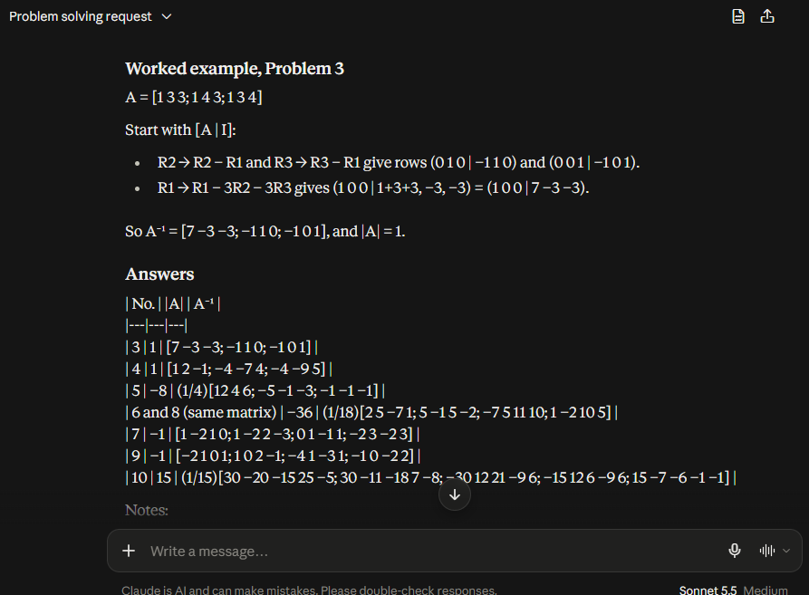
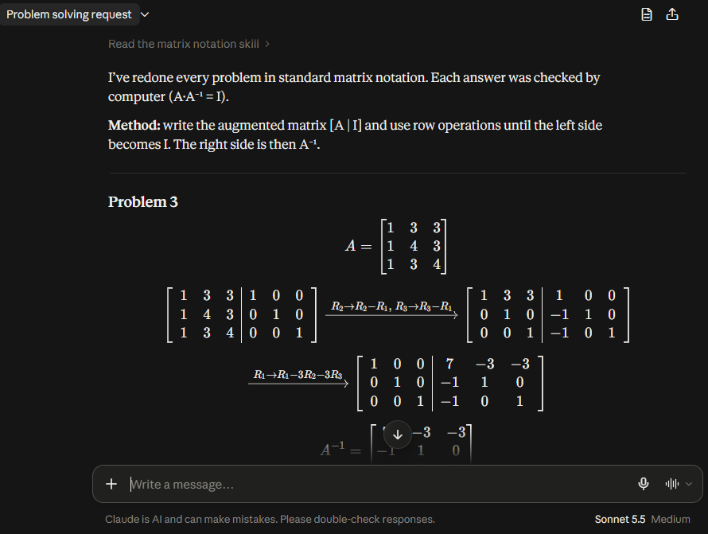

# Standard Matrix Notation for Claude

A Claude skill that makes mathematical explanations easier to read by enforcing standard mathematical notation for matrices, vectors, and linear algebra calculations.

Instead of displaying matrices as programming-style nested lists, the skill instructs Claude to use properly formatted LaTeX with aligned rows and columns, similar to standard mathematics textbooks.

<p float="left">
  
  
</p>
<p>Before Vs After</p>

## Features

- **Matrix Formatting:** Displays matrices using standard notation with properly aligned rows and columns.
- **Linear Algebra:** Covers determinants, cofactor matrices, adjugates, inverses, vectors, and augmented matrices.
- **Step-by-Step Calculations:** Encourages readable, multi-line mathematical derivations instead of compressed expressions.
- **Beginner-Friendly Explanations:** Promotes clear mathematical presentation to make learning and understanding easier.
- **Code Notation When Appropriate:** Allows array and list syntax when discussing programming, NumPy, or data structures.

## Example

Instead of:

```text
A = [[3, -3, 4], [2, -3, 4], [0, -1, 1]]
```

The skill encourages Claude to write:

```text
    [ 3  -3  4 ]
A = [ 2  -3  4 ]
    [ 0  -1  1 ]
```

## Installation

Upload the skill to Claude through its Skills interface and enable it. Once enabled, Claude can apply these formatting guidelines when explaining mathematical concepts.

## Purpose

This project aims to make AI-assisted mathematics learning more readable, particularly for students studying linear algebra and other matrix-heavy topics.

## License

MIT License.
